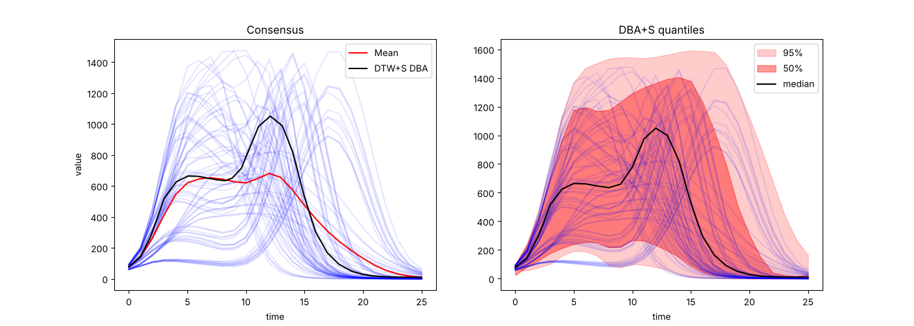

# Shapelet Space Representation Library

`shapelet_space` is a Python library for time series analysis using shapelets. It provides:

- the transformation of short time series into a user-defined shapelet-space representation vector,
- the transformation of longer time series into a matrix where each column is the shapelet-space vector of a rolling window,
- constrained Dynamic Time Warping (DTW) on raw or shapelet-space sequences (DTW+S),
- the consensus (ensemble) of a set of time series and quantiles around it, based on DTW+S.

## Paper Link
https://arxiv.org/pdf/2209.04035.pdf (accepted at IEEE BigData 2022)

## Contents

- [Installation](#installation)
- [Repository layout](#repository-layout)
- [Shapelet space representation](#shapelet-space-representation)
- [Dynamic Time Warping](#dynamic-time-warping)
- [Ensemble (consensus of several time series)](#ensemble-consensus-of-several-time-series)
  - [Quick start](#quick-start)
  - [dtw_s_ensemble](#dtw_s_ensemble)
  - [get_dbas_ensemble (quantiles)](#get_dbas_ensemble-quantiles)
  - [Envelopes](#envelopes)
  - [Lower-level functions](#lower-level-functions)
  - [Differences from the MATLAB code](#differences-from-the-matlab-code)
- [Tests](#tests)
- [License](#license)

## Installation

From PyPI:
```bash
pip install shapelet-space
```

From this repository:
```bash
git clone https://github.com/scc-usc/shapelet-space-rep.git
cd shapelet-space-rep
pip install numpy scipy pandas
```
The package can then be imported from the repository root. `matplotlib` is only needed for the example script.

## Repository layout

| Path | Content |
|---|---|
| `shapelet_space/shapelet.py` | `ShapeletSpace` class: shapelet-space representation of a vector or of a time series. |
| `shapelet_space/dtw.py` | Constrained multi-dimensional DTW (`dtw_cons_md`, `dtw_cons_md_path`). |
| `shapelet_space/ensemble.py` | DTW+S consensus, DBA+S alignment, envelopes, and quantiles. |
| `shapelet_space_matlab/` | Original MATLAB implementation of the shapelet transform and DTW. |
| `examples/ensemble_example.py` | Script that plots the consensus and the quantile bands of `data/flu_sims.csv`. |
| `tests/` | Test suite (`pytest`). |
| `data/flu_sims.csv` | 75 simulated flu curves of 26 weeks, used by the examples and the tests. |

## Shapelet space representation

### find_shapelet_space_ts

- **Description**: Transforms a time series into its shapelet-space representation. Every column of the result is the representation of one rolling window of the series.
- **Usage**:
    ```python
    find_shapelet_space_ts(time_series, slope_thres)
    ```
- **Parameters**:
    - `time_series`: your input data (one-dimensional).
    - `slope_thres`: the average absolute slope that gets a flatness score of 0.1. Windows with a smaller slope score closer to the flat shapelet.
- **Returns**: array of shape `(Number_of_shapelets, len(time_series))`.
- **Example**:
```python
from shapelet_space import shapelet

# Create an instance of the ShapeletSpace class with the default shapelets
# (increase, peak, surge, flat)
shapelet_transformer = shapelet.ShapeletSpace()
# To use custom shapelets:
# shapelet_transformer = shapelet.ShapeletSpace(Shapelet_length, Number_of_shapelets, shapelet_array)

# Define your time series data
time_series = [/* your time series data here */]

# Set a slope threshold
slope_thres = 0.0005  # for example

# Generate the shapelet space representation of the time series
reps = shapelet_transformer.find_shapelet_space_ts(time_series, slope_thres)
```

### shapelet_space_representation

- **Description**: Shapelet-space representation of a single window. The window must have the same length as the shapelets.
- **Usage**:
    ```python
    shapelet_transformer.shapelet_space_representation(vector, slope_thres, type='pearson')
    ```
- **Parameters**:
    - `vector`: a window of the same length as the shapelets.
    - `slope_thres`: see above.
    - `type`: `'pearson'` (correlation with every shapelet, weighted by the flatness) or `'slope-based'`.
- **Returns**: a list with one score per shapelet.

## Dynamic Time Warping

### dtw_cons_md

- **Description**: Constrained DTW distance between two sequences. Every time point can be a vector, for example a shapelet-space vector, which gives DTW+S.
- **Usage**:
    ```python
    dtw_cons_md(sequence_1, sequence_2, win, dist_metric)
    ```
- **Parameters**:
    - `sequence_1`, `sequence_2`: arrays of shape `(dims, N)` and `(dims, M)`. Every column is one time point. One-dimensional arrays are accepted.
    - `win`: Sakoe-Chiba window. Time point `n` of `sequence_1` can only be matched to time point `m` of `sequence_2` when `-win < n - m < win`. A pair `(win_1, win_2)` gives different limits on the two sides. Default: no constraint.
    - `dist_metric`: `'eu'` (squared Euclidean distance between time points, default) or `'cos'` (cosine distance, used when `dims > 1`).
- **Returns**: the DTW distance.
- **Example**:
```python
import numpy as np
from shapelet_space import dtw

sequence_1 = np.array([[0, 1, 2, 1, 0]])      # shape (1, 5)
sequence_2 = np.array([[0, 0, 1, 2, 1, 0]])   # shape (1, 6)

distance = dtw.dtw_cons_md(sequence_1, sequence_2, win=3, dist_metric='eu')
```

### dtw_cons_md_path

- **Description**: Same as `dtw_cons_md`, but also returns the optimal warping path.
- **Usage**:
    ```python
    distance, path_1, path_2 = dtw.dtw_cons_md_path(sequence_1, sequence_2, win, dist_metric)
    ```
- **Returns**: the DTW distance and two integer arrays. `path_1[k]` and `path_2[k]` are the (0-based) indices of `sequence_1` and `sequence_2` that are matched at step `k` of the path.

## Ensemble (consensus of several time series)

The `ensemble` module finds the consensus of a set of time series with DTW+S, and quantiles around it. It is a Python port of the MATLAB code in [DTW_S_apps/ensemble](https://github.com/scc-usc/DTW_S_apps/tree/main/ensemble) and of `get_DBAS_ensemble.m` with its envelope helpers.

A point-wise mean of unaligned series flattens and widens the peaks. The DTW+S consensus first aligns the series in shapelet space and then averages the matched points, so the shape of the individual series is kept. All time indices in the module are 0-based.

### Quick start

```python
import numpy as np
from shapelet_space import ensemble

dd = np.loadtxt('data/flu_sims.csv', delimiter=',')   # shape (n_series, T) = (75, 26)

# Consensus curve
result = ensemble.dtw_s_ensemble(dd, win=10)
result.consensus            # consensus on the time grid 0 .. T-1
result.matches              # time index of every series matched to every time step of the reference

# Quantiles 2.5%, 25%, 50%, 75%, 97.5%
Q = ensemble.get_dbas_ensemble(dd, qq=(0.025, 0.25), win=10, seed=0)
```

On `data/flu_sims.csv` the point-wise mean peaks at 681, while the DTW+S consensus peaks at 1050. The median of the individual peaks is 1123. Run `python examples/ensemble_example.py` from the repository root to reproduce the figure below.



### dtw_s_ensemble

- **Description**: End-to-end consensus of a set of time series. The steps are:
    1. estimate the slope threshold of the shapelet transform (`estimate_slope_threshold`),
    2. transform every series to shapelet space at every time point (`shape_ts_transform`),
    3. align all series to a reference with DTW+S (`find_dtw_matchings`). By default the reference starts as the medoid and is refined with DTW Barycenter Averaging (`dba_s_alignments`),
    4. average the matched points (`dtw_mean_ensemble`).
- **Usage**:
    ```python
    dtw_s_ensemble(dd, shapelet_array=DEFAULT_SHAPELETS, slope_thres=None, win=np.inf, dist_metric='euc', num_iter=10, base=None)
    ```
- **Parameters**:
    - `dd`: array of shape `(n_series, T)`, one time series per row. All series must have the same length and must not contain NaN.
    - `shapelet_array`: one shapelet per row. The default is the increase, peak, surge, and flat shapelets. Pass `None` to align the raw values with plain DTW.
    - `slope_thres`: slope threshold of the shapelet transform. It is estimated from the data when omitted.
    - `win`: DTW window. Default: no constraint. The MATLAB scripts use 10 to 30.
    - `dist_metric`: `'euc'` or `'cos'`.
    - `num_iter`: number of DBA iterations. `0` aligns the series to the medoid only. The iterations stop early when the reference stops changing.
    - `base`: index of a series to use as a fixed reference instead of DBA.
- **Returns**: an `EnsembleResult` with these fields:
    - `mean_time`, `mean_curve`: the consensus as a (time, value) curve, one point per time step of the reference. Times are 0-based and can be fractional.
    - `consensus`: the consensus resampled on the regular time grid `0 .. T-1` (modified Akima interpolation, clipped at 0).
    - `matches`: array of shape `(n_series, T)`. `matches[j, t]` is the time index of series `j` that is matched to time `t` of the reference.
    - `all_values`, `all_times`: value and time of every matched point, shape `(n_series, T)`.
    - `reference`: the reference series. `all_refs` holds the reference of every DBA iteration, starting with the medoid.
    - `reps`: the shapelet-space representations, shape `(n_series, T, d)`.
    - `slope_thres`: the slope threshold that was used.
- **Example**:
```python
import numpy as np
from shapelet_space import ensemble

dd = np.loadtxt('data/flu_sims.csv', delimiter=',')
result = ensemble.dtw_s_ensemble(dd, win=30, num_iter=20)

print(dd.mean(axis=0).max())          # peak of the point-wise mean (flattened)
print(result.consensus.max())         # peak of the DTW+S consensus

import matplotlib.pyplot as plt
plt.plot(dd.T, color='b', alpha=0.1)
plt.plot(dd.mean(axis=0), 'r', label='Mean')
plt.plot(result.mean_time, result.mean_curve, 'k', label='DTW+S DBA')
plt.legend()
```

### get_dbas_ensemble (quantiles)

- **Description**: Quantiles of a set of time series with the DBA+S ensemble. Port of `get_DBAS_ensemble.m`. The series are aligned with DTW Barycenter Averaging in shapelet space. For every event (time step of the reference) the matched points of all series form a cloud. The points farthest from the consensus are dropped so that a fraction `1 - 2q` remains, the convex hull of the rest is taken, and the lower and upper envelopes of the union of the hulls give the quantiles `q` and `1 - q`. The median is the final DBA reference.
- **Usage**:
    ```python
    get_dbas_ensemble(dd, qq=(0.025, 0.25), win=10, shapelet_array=DEFAULT_SHAPELETS, slope_thres=None, num_iter=None, seed=None, return_result=False)
    ```
- **Parameters**:
    - `dd`: array of shape `(n_series, T)`.
    - `qq`: lower quantiles in `[0, 0.5)`. The upper quantiles are added by symmetry and 0.5 is always included. `(0.05, 0.1, 0.25)` gives the rows `0.05, 0.1, 0.25, 0.5, 0.75, 0.9, 0.95`.
    - `win`: DTW window (default 10).
    - `num_iter`: number of DBA iterations. Default: `win`, as in the MATLAB code.
    - `seed`: seed of the random jitter used by the envelopes. Set it for repeatable results.
    - `return_result=True` also returns the `EnsembleResult` of the alignment.
- **Returns**: array of shape `(2 * len(qq) + 1, T)`, one quantile curve per row from the lowest to the highest quantile. `quantile_levels(qq)` gives the level of every row.
- **Example**:
```python
import numpy as np
from shapelet_space import ensemble

dd = np.loadtxt('data/flu_sims.csv', delimiter=',')
Q = ensemble.get_dbas_ensemble(dd, qq=(0.025, 0.25), win=10, seed=0)
levels = ensemble.quantile_levels((0.025, 0.25))     # [0.025, 0.25, 0.5, 0.75, 0.975]

import matplotlib.pyplot as plt
t = np.arange(dd.shape[1])
plt.plot(dd.T, color='b', alpha=0.1)
plt.fill_between(t, Q[0], Q[4], color='r', alpha=0.2, label='95%')
plt.fill_between(t, Q[1], Q[3], color='r', alpha=0.4, label='50%')
plt.plot(t, Q[2], 'k', label='median')
plt.legend()
```
- **Notes**:
    - The envelopes are built independently for every confidence level, so the quantile curves are not guaranteed to be nested at every time step. Small crossings can occur at the first and last time steps.
    - The quantile curves are not clipped at 0, as in the MATLAB code. Pass `clip_negative=True` to `envelope_quantiles` when you need that.
    - The envelopes use random jitter. Results change from run to run unless `seed` is set.

### Envelopes

- `find_envelopes(dd, dtw_matches, confidence=0.95, method='none', poly_method='', jitter=0.1, seed=None)`: lower and upper envelopes of the matched points at one confidence level. Port of `find_envelops.m`. Returns an `EnvelopeResult` with `lower_time`, `lower`, `upper_time`, `upper`, and the convex hull of every event in `hulls`.
    - `method`: `'none'` (envelope interpolated on the time grid), `'strict'` (grid segments pushed outward in steps of `strict_step` until no hull point lies outside), or `'combo'` (grid points merged with the boundary points; the time arrays are then not the grid).
    - `poly_method`: a value containing `'2d'` selects the points of every event per axis. Any other value (the MATLAB code uses `'dense'`) selects them by their normalised distance to the consensus point.
    - `jitter`: relative random jitter applied to the points before the hull is taken (the MATLAB code uses 0.1). Pass 0 to disable.
- `envelope_quantiles(dd, dtw_matches, quantiles, method='strict', poly_method='dense', median=None, clip_negative=False, seed=None)`: quantile curves on the time grid from the envelopes, for any alignment (for example `result.matches` of `dtw_s_ensemble`). `quantiles` can be any levels in `[0, 1]`.
- `calculate_covering_lengths`, `convex_hull_degen_confidence`, `generate_midpoints`, `is_intersect_with_sides`: ports of the MATLAB helpers with the same names.

### Lower-level functions

- `shape_ts_transform(dd, shapelet_array, slope_thres)`: shapelet-space representation of every time point of every series, shape `(n_series, T, d)`. The window is centred on the time point and the ends are padded.
- `estimate_slope_threshold(dd, window)`: slope threshold used in the MATLAB scripts (median over series of the maximum moving-mean absolute slope).
- `find_dtw_matchings(all_reps, dtw_win, dtw_metric, base_m)`: align every series to series `base_m`. Returns the integer matches of shape `(n_series, T)`.
- `dtw_mean_ensemble(dd, dtw_matches)`: average the matched points. Returns `mean_curve`, `mean_time`, `all_values`, `all_times`.
- `resample_to_grid(mean_time, mean_curve, T)`: interpolate a (time, value) curve on the grid `0 .. T-1` with the modified Akima method.
- `dba_s_alignments(dd, all_reps, shapelet_array, slope_thres, win, dist_metric, num_iter)`: iterative refinement of the reference (DTW Barycenter Averaging in shapelet space). Returns the matches, the final reference, and the reference of every iteration.
- `pairwise_dtw_distances(all_reps, win, dist_metric)` and `find_medoid(...)`: DTW+S distance matrix between all pairs of series and the medoid. The distance matrix can be used to cluster the series before building the consensus of one cluster.

### Differences from the MATLAB code

The Python functions follow the MATLAB code, with these intentional changes:

- Time indices are 0-based. `mean_time` is one less than MATLAB's `meanT`.
- `find_dtw_matchings` indexes every row by the time of the base series, so the output always has shape `(n_series, T)`. The MATLAB function stores the full warping path for the first aligned series, which does not line up with the other rows when that path has repeated indices.
- `dba_s_alignments` returns the matches of the input series only. The MATLAB function also returns the row of the reference series, which `dtw_mean_ensemble` then counts as an extra copy of the first series.
- `generate_midpoints` returns only the points along the hull edges. The MATLAB function allocates more slots than it fills, so every hull adds points at (0, 0) to the union of hulls, which pulls both envelopes toward 0 at the first time step.
- The envelope boundary trace also processes the last profile point, so the end of the envelope is interpolated rather than extrapolated.
- When a covering length is zero, `convex_hull_degen_confidence` falls back to the per-axis selection instead of dividing by zero.

## Tests
```bash
pip install numpy scipy pandas pytest
python -m pytest tests
```

## License
This project is licensed under the MIT License - see the [LICENSE.md](LICENSE.md) file for details.
